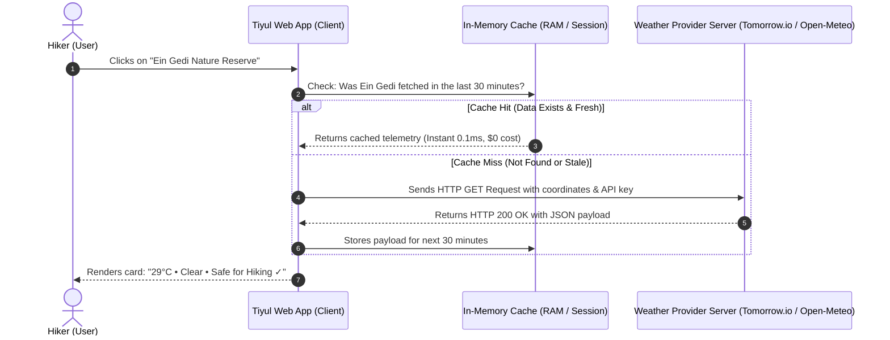
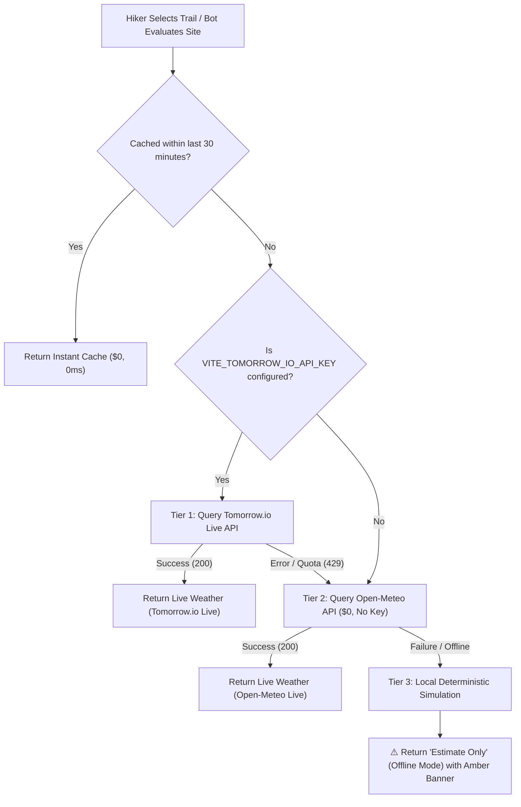
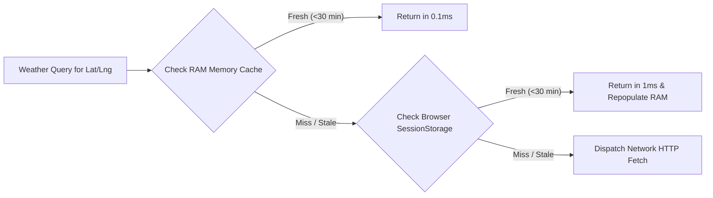

# Weather API Specification & Developer Guide

> **Important Note:** This document is part of the **"Tiyul Geo-Guard" (הסוכן המטייל)** platform. It serves as both a beginner-friendly technical guide and a formal API specification detailing meteorological integrations, the zero-cost multi-tier fallback architecture, and the mandatory **"Estimate Only"** transparency policy when operating in offline mode (Tier 3).

---

## 📚 Chapter 1: API Fundamentals — What is an API and How Does It Work?

### 1.1 What is an API?
An **API** (**Application Programming Interface**) is a digital bridge or contract that enables two different software systems to communicate and exchange structured data over the internet.

* **The Client:** Our application (the web app running in the hiker's browser).
* **The Server:** A remote computer operated by a weather service provider (e.g., Tomorrow.io or Open-Meteo) hosting satellites, radar data, and physical atmosphere models.
* **The Request:** The client asks: *"What is the current temperature and precipitation risk at Ein Gedi?"*
* **The Response:** The server answers: *"29°C, clear skies, 0% rain probability."*



---

### 1.2 Anatomy of an HTTP Request
When communicating with web APIs, we use the standard **HTTP** (Hypertext Transfer Protocol). An API request consists of four core building blocks:

1. **HTTP Method (The Action):**
   * `GET` — Requests data without altering anything on the server (used for weather queries).
   * `POST` — Submits new data to the server (e.g., creating a user account).
   * `PUT` / `PATCH` — Updates existing records on the server.
   * `DELETE` — Removes a resource.
2. **Endpoint (The URL):**
   The specific web address hosted by the server dedicated to handling this operation.  
   *Example:* `https://api.tomorrow.io/v4/weather/forecast`
3. **Query Parameters:**
   Key-value pairs appended to the URL after a `?` symbol and separated by `&`:
   * `location=31.4655,35.3884` (Geographic latitude and longitude coordinates)
   * `timesteps=1d` (Temporal granularity: daily forecast)
   * `units=metric` (Returns Celsius and km/h instead of Fahrenheit and mph)
   * `apikey=YOUR_API_KEY` (The caller's authentication credential)
4. **HTTP Status Codes:**
   * `200 OK` — Success! The data was retrieved and returned.
   * `400 Bad Request` — Invalid input parameters (e.g., missing coordinates).
   * `401 Unauthorized` — The API key is missing, invalid, or expired.
   * `429 Too Many Requests` — Rate limit exceeded (free-tier quota exhausted).
   * `500 Internal Server Error` — Remote server breakdown on the provider's side.

---

## 🏗️ Chapter 2: The Multi-Tier Zero-Cost Architecture

In compliance with our repository's hardcoded rule (**$0 Operating Cost** in `AGENTS.md`), the weather engine ([WeatherService.js](file:///c:/Projects/Tyul/src/services/WeatherService.js)) implements a resilient three-tier fallback architecture:



| Tier | Provider | API Key Required? | Cost | User Transparency Badge |
| :--- | :--- | :---: | :---: | :--- |
| **Tier 1** | **Tomorrow.io** | Yes (`VITE_TOMORROW_IO_API_KEY`) | Free tier up to 500 req/day | `🟢 Live Weather (Tomorrow.io Live)` |
| **Tier 2** | **Open-Meteo** | **No** (Open academic endpoint) | **Strict $0 always** | `🟢 Live Weather (Open-Meteo Live)` |
| **Tier 3** | **Local Offline Simulation** | **No** (Local heuristics) | **Strict $0 always** | `⚠️ Estimate Only (Offline Mode)` |

---

## 📡 Chapter 3: Tier 1 Specification — Tomorrow.io API

### 3.1 Request Specification
* **HTTP Method:** `GET`
* **Base URL:** `https://api.tomorrow.io/v4/weather/forecast`
* **Headers:** `Accept: application/json`

### 3.2 Query Parameters
| Parameter | Type | Required? | Example | Description |
| :--- | :--- | :---: | :--- | :--- |
| `location` | `string` | Yes | `31.4655,35.3884` | Comma-separated `latitude,longitude` coordinates |
| `timesteps` | `string` | Yes | `1d` | Timeline interval (`1d` for daily forecast, `1h` for hourly) |
| `apikey` | `string` | Yes | `a8b9c0d1e2f3...` | Your secret Tomorrow.io API token |
| `units` | `string` | No | `metric` | Metric units (°C, km/h). Default is imperial. |

### 3.3 Example cURL Request
```bash
curl -X GET "https://api.tomorrow.io/v4/weather/forecast?location=31.4655,35.3884&timesteps=1d&units=metric&apikey=YOUR_API_KEY" \
     -H "Accept: application/json"
```

### 3.4 Response Structure (JSON)
```json
{
  "timelines": {
    "daily": [
      {
        "time": "2026-10-12T00:00:00Z",
        "values": {
          "temperatureMax": 29.4,
          "temperatureMin": 20.8,
          "temperatureAvg": 25.1,
          "precipitationProbabilityMax": 0,
          "windSpeedAvg": 4.1,
          "humidityAvg": 48,
          "weatherCodeMax": 1000
        }
      }
    ]
  }
}
```

### 3.5 Weather Code Mapping Table
Tomorrow.io returns an integer code in `weatherCodeMax`. The client maps this code to localized Hebrew/English descriptions and safety verdicts:

| Code | Tomorrow.io Meaning | Localized Description | Hiking Safety Verdict |
| :---: | :--- | :--- | :--- |
| **1000** | Clear, Sunny | **בהיר ושמשי ☀️ (Clear & Sunny)** | Safe ✓ |
| **1100** | Mostly Clear | **בהיר ברובו 🌤️ (Mostly Clear)** | Safe ✓ |
| **1101** | Partly Cloudy | **מעונן חלקית ⛅ (Partly Cloudy)** | Safe ✓ |
| **1001** | Cloudy | **מעונן ☁️ (Overcast)** | Safe ✓ |
| **4000** | Drizzle | **טפטוף קל 🌦️ (Light Drizzle)** | Slippery surface caution ⚠️ |
| **4001** | Rain | **גשם מקומי 🌧️ (Local Rain)** | Flash flood alert in wadis ⚠️ |
| **4201** | Heavy Rain | **גשם כבד ⛈️ (Heavy Rain)** | **Critical: Trail Closed / Flash Floods ✗** |
| **8000** | Thunderstorm | **סופת רעמים וברקים ⚡ (Thunderstorm)** | **Critical: Lightning & Flood Hazard ✗** |

---

## 🌐 Chapter 4: Tier 2 Specification — Open-Meteo (Zero Cost, No Key)

Open-Meteo is an open-source weather initiative partnered with national weather services. It provides high-resolution European and Israeli weather forecasts without registration or keys.

### 4.1 Request Specification
* **HTTP Method:** `GET`
* **Base URL:** `https://api.open-meteo.com/v1/forecast`
* **Recommended Query Parameters:**
  ```text
  ?latitude=31.4655
  &longitude=35.3884
  &daily=weather_code,temperature_2m_max,temperature_2m_min,precipitation_probability_max,wind_speed_10m_max
  &timezone=auto
  ```

---

## 🛡️ Chapter 5: Tier 3 Specification — Offline Mode & Mandatory Transparency

> [!IMPORTANT]
> **Strict Operational Transparency Policy:**  
> When operating in offline mode (e.g., zero field reception or all third-party APIs failing), the system **must never present simulated values as live measurements**. It must explicitly and visibly indicate to the hiker that the data is an **"Estimate Only"** based on regional climate heuristics.

### 5.1 Internal JavaScript Return Object
```javascript
{
  isLive: false,                           // Flag: Not fetched from a live network server
  isSimulated: true,                       // Flag: Computed via local model
  isEstimateOnly: true,                    // Explicit flag: Estimate Only
  source: 'הערכה בלבד (סימולציית אופליין)',    // Data source label
  badgeText: '⚠️ הערכה בלבד (מצב לא מקוון)', // UI pill badge text
  disclaimer: 'נתוני מזג האוויר מוערכים על בסיס מודל אזורי עקב היעדר תקשורת חיה.',
  temp: '26°C',
  tempMax: 26,
  tempMin: 18,
  precipProb: 5,
  conditions: 'בהיר ונוח',
  heatLoad: 'נוח לטיול'
}
```

### 5.2 User Interface (UI / UX) Reflection
1. **Interactive Trail Card ([FloatingMapCard.jsx](file:///c:/Projects/Tyul/src/components/FloatingMapCard.jsx)):**
   * Instead of the emerald `🟢 Live Weather` badge, the footer renders a prominent amber alert badge (`text-amber-400`):  
     `⚠️ הערכה בלבד (מצב לא מקוון / Offline)`
2. **AI Hiking Agent Verdicts ([AgentRulesEngine.js](file:///c:/Projects/Tyul/src/services/agent/AgentRulesEngine.js)):**
   * All recommendations generated under Tier 3 explicitly include:  
     `26°C (בהיר ונוח) • הערכה בלבד (Offline)`

---

## ⚡ Chapter 6: Caching Layer & Rate Limiting Defense

To prevent redundant API queries, preserve device battery, and stay comfortably within free-tier limits, we employ a two-level caching strategy:



1. **TTL (Time-To-Live):** 30 minutes (`CACHE_TTL_MS = 30 * 60 * 1000`).
2. **Spatial Coordinate Key:** Latitude and longitude are rounded to 3 decimal places (e.g., `31.465,35.388`), meaning nearby points of interest within ~100m share the same weather payload.

---

## 💻 Chapter 7: Hands-On Vanilla JavaScript Code Example

The following self-contained JavaScript snippet demonstrates how to query Tomorrow.io with automated Tier 3 offline fallback:

```javascript
/**
 * Fetches trail weather from Tomorrow.io with graceful fallback to Estimate Only mode.
 * @param {number} lat - Latitude
 * @param {number} lng - Longitude
 * @param {string} apiKey - Tomorrow.io API Key
 * @returns {Promise<Object>} Formatted weather object
 */
async function getTrailWeather(lat, lng, apiKey) {
  const endpoint = `https://api.tomorrow.io/v4/weather/forecast?location=${lat},${lng}&timesteps=1d&units=metric&apikey=${apiKey}`;

  try {
    console.log("📡 Dispatching request to Tomorrow.io...");

    const response = await fetch(endpoint, {
      method: "GET",
      headers: { "Accept": "application/json" }
    });

    if (!response.ok) {
      throw new Error(`HTTP Error: ${response.status} ${response.statusText}`);
    }

    const json = await response.json();
    const todayValues = json?.timelines?.daily?.[0]?.values;

    if (!todayValues) {
      throw new Error("Malformed timeline payload from provider.");
    }

    return {
      isLive: true,
      isEstimateOnly: false,
      source: "Tomorrow.io Live",
      temperature: Math.round(todayValues.temperatureMax),
      rainChance: todayValues.precipitationProbabilityMax,
      weatherCode: todayValues.weatherCodeMax,
      badgeText: `🟢 Live Weather: ${Math.round(todayValues.temperatureMax)}°C`
    };

  } catch (error) {
    console.warn("⚠️ API fetch failed or network offline. Falling back to Tier 3:", error.message);

    // Fallback Tier 3: Deterministic regional estimation
    return {
      isLive: false,
      isEstimateOnly: true,
      source: "Estimate Only (Offline)",
      temperature: 26,
      rainChance: 0,
      badgeText: "⚠️ Estimate Only (Offline Mode): ~26°C"
    };
  }
}

// ── Quick Test Run ──────────────────────────────────────────
// getTrailWeather(31.4655, 35.3884, "YOUR_API_KEY").then(console.log);
```

---

## 🔒 Chapter 8: Security Best Practices for API Keys

> [!CAUTION]
> **Never commit hardcoded API keys into Git or public repositories!**  
> Automated bots crawl GitHub 24/7 and will compromise exposed keys within seconds.

### The Standard Environment Variable Workflow:
1. Store keys in a `.env` file at the root of your project:
   ```env
   VITE_TOMORROW_IO_API_KEY=your_secret_api_key_here
   ```
2. Verify that `.env` is listed inside `.gitignore`.
3. In client code built with Vite, reference the variable securely:
   ```javascript
   const apiKey = import.meta.env.VITE_TOMORROW_IO_API_KEY;
   ```

---

## 📝 Developer Checklist

* [x] **API Concept:** Understood client-server request/response communication.
* [x] **HTTP Mechanics:** Mastered `GET` requests, query parameters, and status codes (`200`, `401`, `429`).
* [x] **Multi-Tier Resilience:** Configured three layers of fallbacks for 100% uptime at $0 cost.
* [x] **Estimate Only Transparency:** Ensured offline simulations are distinctly flagged with amber warning badges.
* [x] **Credential Hygiene:** Secured API keys using `.env` environment variables.
